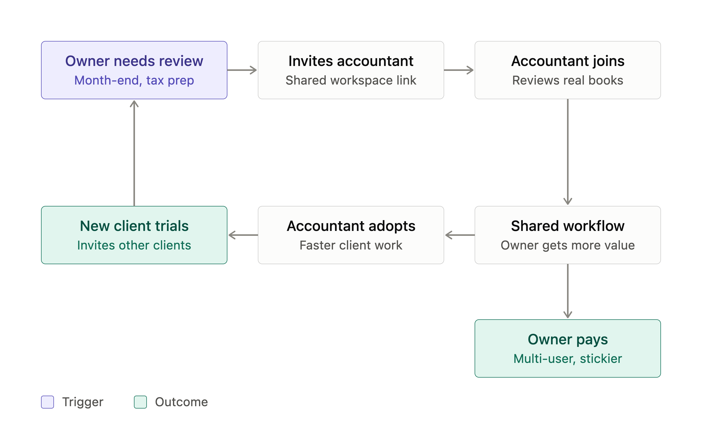

# The Bet · FinWise

> Module 1 · Ignite a PLG Motion. The growth hypothesis and where you're betting, plus the growth-loop visualization.

## Growth hypothesis

FinWise's biggest growth problem is that growth depends entirely on paid acquisition, while only about 2% of trials convert to paid regardless of spend or engagement, because trial users come in alone through paid channels and use FinWise as a single-player tool, even though small-business finance involves accountants, bookkeepers and partners.

_Working notes: I think FinWise's biggest problem is activation. Most trial users never reach the product's core value (seeing their own finances organized and useful), so they don't convert. Those who do convert often haven't built a habit, so they churn. Evidence: 2% trial-to-paid is very low for a reverse trial - if almost no one converts after experiencing the full trial, they likely aren't experiencing anything at all.
60% of paying customers churn within a year. Even the people who pay aren't getting lasting value.
More acquisition spend no longer drives growth - extra trial users flow into same 2% conversion and 40% retention. Against the data: The biggest proportional leak is exactly where I expected, at trial-to-paid, and paid conversions rise and fall almost one-for-one with trials. Nothing downstream is improving the yield. But there's no evidence that there's a relationship with trial-to-paid. Even when import and modeling usage rose, conversion stayed flat and churn went up._

_____

## The bet

The highest-leverage experiment I'd run first is a collaboration loop that prompts trial users to invite their accountant or bookkeeper after their first data import, A/B tested over 6 weeks with trial-to-paid conversion as the primary metric.

**Not doing:** I'm not going after more paid acquisition or the swings in visit-to-trial conversion, because focusing there would pull effort from the bet above.

_____

## Growth loop

**Loop type:** Collaboration, I would experiment with a collaboration loop because small businesses already manage their finances with accountants, bookkeepers and partners, so letting them invite those people brings in high-intent users at no acquisition cost and makes accounts stickier. Referral and content loops would only add more users to a funnel that converts at 2%.

