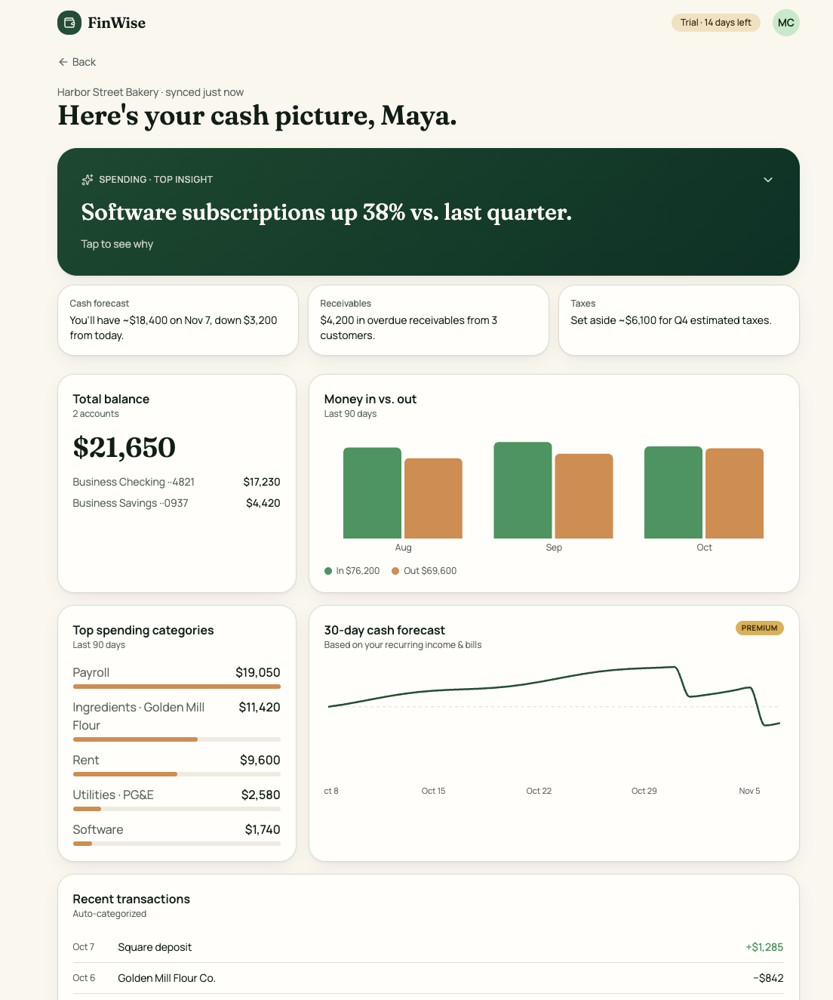

# The Solution · FinWise

> Module 2 · Acquisition & Activation. The onboarding solution and the Aha moment that makes value land.

## Aha moment

“I can see my real cash position, and where it’s heading, without having built a spreadsheet.” In practice, that’s the first time a user sees their own bank transactions auto-categorized into a cash-in/cash-out view, with a short forward forecast, such as “projected balance in 30 days.”

_____

## Onboarding prototype

[Prototype link](https://finwise-demo22.lovable.app)

_____

## Why this activates

This works because it puts the user’s own money in front of them, auto-categorized and projected 30 days ahead, in one session and about four taps. Every screen either removes typing, aims the payoff at what they care about, or brings in their real data. The alert then gives them a reason to return before the trial ends.

The friction I removed was everything a small-business owner would have to do before seeing value: passwords, profile forms, settings, team invites, tours, and above all a blank dashboard waiting for manual data entry. What’s left is one decision and one act of trust: connecting the bank.

That matters because it predicts conversion. A user who has seen their own forecast has reached the product’s core value, and in a reverse trial they’ve reached it through a premium feature. Downgrading then means losing a view of their own cash, which makes it a real loss. Track first-session bank connection plus a forecast view. If that cohort beats today’s 2%, the flow is working.

_____
