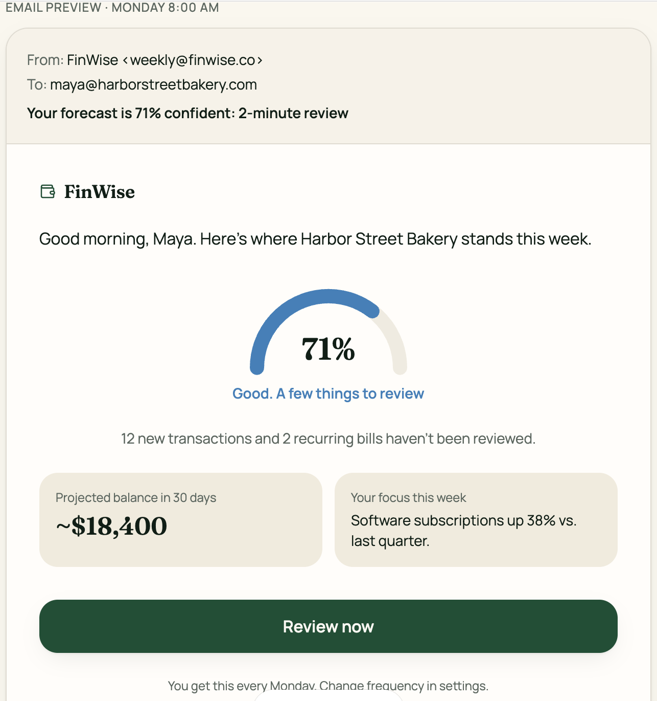

# The Mechanic · FinWise

> Module 3 · Retention & Engagement. The engagement mechanic that builds the habit loop, with rationale and a wireframe.

## The mechanic

**Mechanic:** Custom

- **Trigger:** The Monday email shows forecast confidence slipping, for example “71% confident: 2-minute review.”
- **Action:** The owner opens the review and confirms new transactions and recurring bills with one tap each.
- **Reward:** The gauge climbs back and the forecast band narrows, followed by a one-line insight tied to their goal (“Cash looks steady through Nov 20”).
- **Investment:** Each confirmation teaches FinWise their categories and bills, so next week’s forecast is more accurate and the review is faster.

_____

## Rationale

FinWise’s churn appears to come from two sources: customers try financial modeling but don’t get forecasts they trust, and the product has turned into a quick check-in tool rather than somewhere real work gets done. The Forecast Confidence meter turns those short, low-value check-ins into a two-minute weekly habit that keeps the user’s forecast accurate. That speaks to the data showing modeling usage nearly doubling (25% to 47%) while sessions got shorter and churn rose by about half. Because users can see that a reliable forecast depends on their reviewed transactions, the feature makes modeling trustworthy and gives them a concrete reason to keep coming back, and to renew.

_____

## Wireframe

_____
